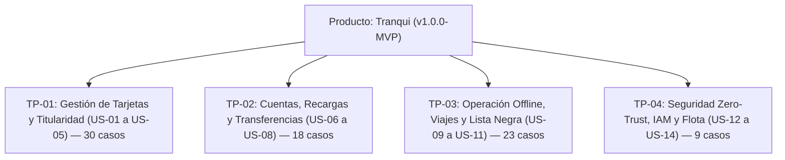

# Catálogo Maestro de Pruebas para Kiwi TCMS — Proyecto Tranqui

Este documento organiza la totalidad de las **14 Historias de Usuario (`US-01` a `US-14`)** y los **80 Casos de Prueba (`TC-001` a `TC-080`)** definidos en las especificaciones del proyecto **Tranqui**, estructurados con los campos exactos que solicita **Kiwi TCMS** (`Summary`, `Component`, `Setup / Precondiciones`, `Actions / Pasos`, `Expected Result / Resultado Esperado`).

---

## 1. Configuración Base en Kiwi TCMS

Antes de cargar los planes y casos, registra estos elementos base en tu servidor de Kiwi TCMS:

* **Product (Producto):** `Tranqui`
* **Version:** `v1.0.0-MVP`

### Componentes del Producto (`Components`)

| Componente en Kiwi | Módulos / Alcance | Historias Asociadas |
| :--- | :--- | :--- |
| **`Tarjeta`** | Ciclo de vida del plástico, categorías tarifarias, vinculación, extravío y fraude | `US-01`, `US-02`, `US-03`, `US-04`, `US-05` |
| **`Cuenta`** | Saldos, confirmación de recargas, transferencias e historial de movimientos | `US-06`, `US-07`, `US-08` |
| **`Validador-ESP32`** | Abordaje offline NFC, tarifas locales, margen de deuda y firmas criptográficas | `US-09`, `US-14` |
| **`Viaje`** | Sincronización idempotente de lotes de viajes, conciliación contable y deuda | `US-10` |
| **`Lista-Negra`** | Distribución por deltas HTTP, Cuckoo Filter completo, push urgente MQTT y purga | `US-11` |
| **`IAM`** | Registro único por DNI, autenticación JWT y roles aditivos (RBAC) | `US-12` |
| **`Flota`** | Registro de buses, vinculación de hardware ESP32 y reporte de ganancias | `US-13` |

### Planes de Prueba Sugeridos (`Test Plans`)

---

## 2. Plan de Pruebas 1 (`TP-01`): Gestión de Tarjetas y Titularidad

* **Plan Name:** `TP-01: Gestión de Tarjetas y Titularidad`
* **Plan Type:** `Functional / Integration`
* **Componente Principal:** `Tarjeta`

---

### US-01: Emisión Inicial de Tarjeta
* **Especificación:** [US-01-emitir_tarjeta.md](file:///c:/Users/eliak/OneDrive/Desktop/Tranqui/Backend/tranqi-backend/backend/.specs/features/tarjeta/US-01-emitir_tarjeta.md) | [emitir_tarjeta.feature](file:///c:/Users/eliak/OneDrive/Desktop/Tranqui/Backend/tranqi-backend/backend/.specs/features/tarjeta/emitir_tarjeta.feature)
* **Regla clave:** Emisión anónima (`userId = null`), relación `1:1` con nueva `Cuenta`, validación documental según categoría tarifaria.

| ID | Summary (Título en Kiwi) | Prioridad | Setup (Precondiciones) | Actions (Pasos) | Expected Result (Resultado Esperado) |
| :--- | :--- | :---: | :--- | :--- | :--- |
| **TC-001** | `[US-01]` Emisión exitosa de tarjeta con categoría GENERAL de forma anónima | Alta | Agente `AGT-001` en `PRC-001`. Tarjeta `TRK-1001` en estado `EN_INVENTARIO`. | 1. El agente `AGT-001` solicita emitir la tarjeta `TRK-1001` con categoría `GENERAL` sin documento adicional. | • `TRK-1001` pasa a estado `ACTIVE`. • Se crea cuenta con `userId = null` y saldo inicial `5.00`. • `kioskAgentId = AGT-001`. • Se genera `verificationNumber` de 12 dígitos (`SecureRandom`). • Se emite evento `TarjetaEmitida`. |
| **TC-002** | `[US-01]` Emisión exitosa de tarjeta con categoría ESCOLAR con DNI válido | Alta | Agente `AGT-001` en `PRC-001`. Tarjeta `TRK-1002` en estado `EN_INVENTARIO`. | 1. Solicitar emisión de `TRK-1002` con categoría `ESCOLAR` presentando DNI vigente `DOC-DNI-2026`. | • `TRK-1002` pasa a estado `ACTIVE`. • Cuenta creada con `fareCategory = ESCOLAR`, saldo inicial `2.50` y `userId = null`. • Se emite evento `TarjetaEmitida`. |
| **TC-003** | `[US-01]` Emisión exitosa de tarjeta con categoría UNIVERSITARIO con carnet válido | Alta | Agente `AGT-001` en `PRC-001`. Tarjeta `TRK-1003` en estado `EN_INVENTARIO`. | 1. Solicitar emisión de `TRK-1003` con categoría `UNIVERSITARIO` presentando carnet `DOC-CARNET-2026` vigente. | • `TRK-1003` pasa a estado `ACTIVE`. • Cuenta creada con `fareCategory = UNIVERSITARIO`, saldo inicial `5.00` y `userId = null`. • Se emite evento `TarjetaEmitida`. |
| **TC-004** | `[US-01]` Rechazo de emisión de tarjeta ESCOLAR con DNI inválido o vencido | Media | Tarjeta `TRK-1001` en estado `EN_INVENTARIO`. | 1. Solicitar emisión de `TRK-1001` con categoría `ESCOLAR` presentando DNI expirado `DOC-DNI-VENCIDO`. | • Solicitud rechazada por documento inválido. • `TRK-1001` permanece `EN_INVENTARIO`. • No se crea cuenta. • Se emite `EmisionRechazadaPorDocumentoInvalido`. |
| **TC-005** | `[US-01]` Rechazo de emisión de tarjeta UNIVERSITARIO con carnet inválido | Media | Tarjeta `TRK-1002` en estado `EN_INVENTARIO`. | 1. Solicitar emisión de `TRK-1002` con categoría `UNIVERSITARIO` presentando carnet `DOC-CARNET-INVALIDO`. | • Solicitud rechazada por documento inválido. • `TRK-1002` permanece `EN_INVENTARIO`. • No se crea cuenta. • Se emite `EmisionRechazadaPorDocumentoInvalido`. |
| **TC-006** | `[US-01]` Rechazo al intentar emitir una tarjeta que ya está activa | Alta | Tarjeta `TRK-9001` en estado `ACTIVE` asociada a `CTA-901`. | 1. Solicitar emisión de `TRK-9001` con categoría `GENERAL`. | • Solicitud rechazada porque la tarjeta ya está activa. • `TRK-9001` mantiene su cuenta `CTA-901` sin cambios. |
| **TC-007** | `[US-01]` Unicidad global del `verificationNumber` generado al emitir tarjeta | Media | Existe una tarjeta con `verificationNumber = 123456789012`. Tarjeta `TRK-1004` `EN_INVENTARIO`. | 1. Solicitar emisión de `TRK-1004` con categoría `GENERAL`. | • El sistema genera un `verificationNumber` distinto de `123456789012`. • `TRK-1004` pasa a `ACTIVE` y se emite `TarjetaEmitida`. |

---

### US-02: Cambio de Categoría Tarifaria de Tarjeta
* **Especificación:** [US-02-cambiar_categoria_tarifaria.md](file:///c:/Users/eliak/OneDrive/Desktop/Tranqui/Backend/tranqi-backend/backend/.specs/features/tarjeta/US-02-cambiar_categoria_tarifaria.md) | [cambiar_categoria_tarifaria.feature](file:///c:/Users/eliak/OneDrive/Desktop/Tranqui/Backend/tranqi-backend/backend/.specs/features/tarjeta/cambiar_categoria_tarifaria.feature)
* **Regla clave:** Solo tarjetas `ACTIVE` pueden cambiar de categoría; se conserva intacto el saldo y la cuenta.

| ID | Summary (Título en Kiwi) | Prioridad | Setup (Precondiciones) | Actions (Pasos) | Expected Result (Resultado Esperado) |
| :--- | :--- | :---: | :--- | :--- | :--- |
| **TC-008** | `[US-02]` Actualización exitosa de GENERAL a ESCOLAR con DNI válido | Alta | Tarjeta `TRK-2001` `ACTIVE`, cuenta `CTA-201` con categoría `GENERAL`. | 1. Agente `AGT-001` solicita cambiar categoría de `CTA-201` a `ESCOLAR` presentando DNI vigente `DOC-DNI-2026`. | • `CTA-201` actualiza `fareCategory` a `ESCOLAR`. • Saldo inalterado. • Se emite `CategoriaTarifariaActualizada`. |
| **TC-009** | `[US-02]` Actualización exitosa de GENERAL a UNIVERSITARIO con carnet válido | Alta | Tarjeta `TRK-2001` `ACTIVE`, cuenta `CTA-201` con categoría `GENERAL`. | 1. Solicitar cambio de `CTA-201` a `UNIVERSITARIO` con carnet vigente `DOC-CARNET-2026`. | • `CTA-201` actualiza `fareCategory` a `UNIVERSITARIO`. • Saldo inalterado. • Se emite `CategoriaTarifariaActualizada`. |
| **TC-010** | `[US-02]` Retorno exitoso de categoría preferencial a GENERAL sin documento | Media | Tarjeta `TRK-2004` `ACTIVE`, cuenta `CTA-204` con categoría `ESCOLAR`. | 1. Solicitar cambio de `CTA-204` a `GENERAL` sin documento adicional. | • `CTA-204` actualiza `fareCategory` a `GENERAL`. • Se emite `CategoriaTarifariaActualizada`. |
| **TC-011** | `[US-02]` Rechazo de cambio a ESCOLAR con DNI inválido | Media | Tarjeta `TRK-2001` `ACTIVE`, cuenta `CTA-201` (`GENERAL`). | 1. Solicitar cambio a `ESCOLAR` presentando `DOC-DNI-INVALIDO`. | • Solicitud rechazada por documento inválido. • `CTA-201` mantiene `GENERAL`. • Se emite `CambioCategoriaRechazadoPorDocumentoInvalido`. |
| **TC-012** | `[US-02]` Rechazo de cambio a UNIVERSITARIO con carnet inválido | Media | Tarjeta `TRK-2001` `ACTIVE`, cuenta `CTA-201` (`GENERAL`). | 1. Solicitar cambio a `UNIVERSITARIO` presentando `DOC-CARNET-INVALIDO`. | • Solicitud rechazada por documento inválido. • `CTA-201` mantiene `GENERAL`. • Se emite `CambioCategoriaRechazadoPorDocumentoInvalido`. |
| **TC-013** | `[US-02]` Rechazo de cambio de categoría en tarjeta reportada como perdida (`LOST_REPORTED`) | Alta | Tarjeta `TRK-2002` en estado `LOST_REPORTED`, cuenta `CTA-202` (`GENERAL`). | 1. Solicitar cambio de `CTA-202` a `ESCOLAR` con DNI válido `DOC-DNI-2026`. | • Solicitud rechazada porque la tarjeta está reportada como perdida. • `CTA-202` mantiene `GENERAL`. |
| **TC-014** | `[US-02]` Rechazo de cambio de categoría en tarjeta bloqueada por fraude (`BLOQUEADA_FRAUDE`) | Alta | Tarjeta `TRK-2003` en estado `BLOQUEADA_FRAUDE`, cuenta `CTA-203` (`GENERAL`). | 1. Solicitar cambio de `CTA-203` a `ESCOLAR` con DNI válido `DOC-DNI-2026`. | • Solicitud rechazada porque la tarjeta está bloqueada por fraude. • `CTA-203` mantiene `GENERAL`. |

---

### US-03: Configuración y Vinculación de Tarjeta a Usuario
* **Especificación:** [US-03-configurar_tarjeta.md](file:///c:/Users/eliak/OneDrive/Desktop/Tranqui/Backend/tranqi-backend/backend/.specs/features/tarjeta/US-03-configurar_tarjeta.md) | [configurar_tarjeta.feature](file:///c:/Users/eliak/OneDrive/Desktop/Tranqui/Backend/tranqi-backend/backend/.specs/features/tarjeta/configurar_tarjeta.feature)
* **Regla clave:** Vincula tarjeta activa y anónima (`userId = null`) validando hash del código de seguridad; bloqueo al 5to intento fallido.

| ID | Summary (Título en Kiwi) | Prioridad | Setup (Precondiciones) | Actions (Pasos) | Expected Result (Resultado Esperado) |
| :--- | :--- | :---: | :--- | :--- | :--- |
| **TC-015** | `[US-03]` Vinculación exitosa de tarjeta anónima a usuario con código correcto | Alta | Usuario `USR-101`. Tarjeta `TRK-3001` `ACTIVE`, `CTA-301` (saldo `25.00`), `userId = null`, hash de código `4321`. | 1. `USR-101` solicita vincular `TRK-3001` enviando el código `4321`. | • `CTA-301` queda con `userId = USR-101`. • Conserva `CTA-301` y saldo `25.00` sin crear cuenta nueva. • Se emite `CuentaVinculadaAUsuario`. |
| **TC-016** | `[US-03]` Usuario administra múltiples tarjetas simultáneamente | Media | `USR-101` ya tiene vinculada `TRK-3002` (`CTA-302`). `TRK-3001` está anónima con código `4321`. | 1. `USR-101` vincula `TRK-3001` con código `4321`. | • `USR-101` administra simultáneamente las cuentas de `TRK-3001` y `TRK-3002`. |
| **TC-017** | `[US-03]` Rechazo de vinculación por código de seguridad incorrecto | Alta | Tarjeta `TRK-3001` anónima con código esperado `4321`. | 1. `USR-101` intenta vincular `TRK-3001` enviando código `9999`. | • Solicitud rechazada por código inválido. • `CTA-301` permanece con `userId = null`. • Se emite `VinculacionRechazadaPorCodigoInvalido`. |
| **TC-018** | `[US-03]` Validación de código de seguridad contra hash almacenado (nunca texto plano) | Alta | Tarjeta `TRK-3001` con `securityCodeHash`. | 1. `USR-101` envía código de seguridad para vincular `TRK-3001`. | • El sistema verifica contra `securityCodeHash` sin exponer el valor en texto plano. |
| **TC-019** | `[US-03]` Bloqueo de vinculación tras 5 intentos fallidos consecutivos | Alta | `USR-101` acumula 4 intentos fallidos sobre `TRK-3001`. | 1. `USR-101` envía un 5to intento fallido con código `8888`. | • Rechazo definitivo por exceso de intentos. • `TRK-3001` bloqueada para nuevas vinculaciones. • Se emite `VinculacionBloqueadaPorIntentosExcedidos`. |
| **TC-020** | `[US-03]` Rechazo de vinculación de tarjeta que ya tiene propietario asignado | Alta | Tarjeta `TRK-3002` ya vinculada a `USR-101`. | 1. Usuario `USR-102` intenta vincular `TRK-3002`. | • Solicitud rechazada por tener propietario asignado. • `CTA-302` permanece con `userId = USR-101`. |
| **TC-021** | `[US-03]` Rechazo de vinculación de tarjeta en estado `EN_INVENTARIO` | Media | Tarjeta `TRK-3003` en estado `EN_INVENTARIO`. | 1. `USR-101` intenta vincular `TRK-3003`. | • Solicitud rechazada porque la tarjeta no ha sido activada en kiosco. |
| **TC-022** | `[US-03]` Rechazo de vinculación de tarjeta bloqueada por fraude | Media | Tarjeta `TRK-3004` en estado `BLOQUEADA_FRAUDE`. | 1. `USR-101` intenta vincular `TRK-3004`. | • Solicitud rechazada por presentar bloqueo administrativo por fraude. |

---

### US-04: Reporte de Tarjeta Perdida o Robada y Reemplazo
* **Especificación:** [US-04-reportar_tarjeta_perdida.md](file:///c:/Users/eliak/OneDrive/Desktop/Tranqui/Backend/tranqi-backend/backend/.specs/features/tarjeta/US-04-reportar_tarjeta_perdida.md) | [reportar_tarjeta_perdida.feature](file:///c:/Users/eliak/OneDrive/Desktop/Tranqui/Backend/tranqi-backend/backend/.specs/features/tarjeta/reportar_tarjeta_perdida.feature)
* **Regla clave:** Bloquea el plástico extraviado (`LOST_REPORTED`), lo envía a lista negra y reasigna la misma `Cuenta` (`accountId`) a una tarjeta de inventario.

| ID | Summary (Título en Kiwi) | Prioridad | Setup (Precondiciones) | Actions (Pasos) | Expected Result (Resultado Esperado) |
| :--- | :--- | :---: | :--- | :--- | :--- |
| **TC-023** | `[US-04]` Reporte exitoso de tarjeta perdida y paso a lista negra | Crítica | `USR-201` titular de `TRK-4001` (`ACTIVE`, `CTA-401`, saldo `48.50`, `ESCOLAR`). `TRK-4002` `EN_INVENTARIO`. | 1. `USR-201` reporta pérdida de `TRK-4001` solicitando reemplazo con `TRK-4002`. | • `TRK-4001` pasa a estado `LOST_REPORTED`. • `TRK-4001` se añade a lista negra con motivo `PERDIDA_ROBO`. • Se emite `TarjetaReportadaComoPerdida`. |
| **TC-024** | `[US-04]` La tarjeta de reemplazo apunta al mismo `accountId` conservando saldo y tarifa | Crítica | `USR-201` reportó pérdida de `TRK-4001` con reemplazo `TRK-4002`. | 1. Consultar estado y asociación de `TRK-4002` y `CTA-401`. | • `TRK-4002` pasa a `ACTIVE` apuntando a `CTA-401`. • `CTA-401` conserva saldo `48.50`, `fareCategory = ESCOLAR` y `userId = USR-201`. • Se emite `TarjetaDeReemplazoApuntaAMismaCuenta`. |
| **TC-025** | `[US-04]` Rechazo de reporte de pérdida para una tarjeta anónima | Alta | Tarjeta `TRK-4003` `ACTIVE` con `userId = null`. | 1. Solicitar reporte de pérdida de `TRK-4003`. | • Solicitud rechazada por falta de titularidad acreditable. • `TRK-4003` permanece `ACTIVE`. |
| **TC-026** | `[US-04]` Rechazo al reportar tarjeta que ya está en estado `LOST_REPORTED` | Media | Tarjeta `TRK-4004` en estado `LOST_REPORTED` (`USR-201`). | 1. `USR-201` intenta reportar nuevamente `TRK-4004`. | • Solicitud rechazada por encontrarse ya en estado terminal de pérdida. |

---

### US-05: Bloqueo de Tarjeta por Fraude
* **Especificación:** [US-05-bloquear_tarjeta_fraude.md](file:///c:/Users/eliak/OneDrive/Desktop/Tranqui/Backend/tranqi-backend/backend/.specs/features/tarjeta/US-05-bloquear_tarjeta_fraude.md) | [bloquear_tarjeta_fraude.feature](file:///c:/Users/eliak/OneDrive/Desktop/Tranqui/Backend/tranqi-backend/backend/.specs/features/tarjeta/bloquear_tarjeta_fraude.feature)
* **Regla clave:** El estado `BLOQUEADA_FRAUDE` es permanente e inmune a recargas de saldo (a diferencia del bloqueo por deuda).

| ID | Summary (Título en Kiwi) | Prioridad | Setup (Precondiciones) | Actions (Pasos) | Expected Result (Resultado Esperado) |
| :--- | :--- | :---: | :--- | :--- | :--- |
| **TC-027** | `[US-05]` Bloqueo administrativo exitoso de tarjeta activa por sospecha de fraude | Crítica | Tarjeta `TRK-5001` `ACTIVE` (`CTA-501`, saldo `12.00`). | 1. Administrador solicita bloqueo por fraude de `TRK-5001` con motivo `"Patrón anómalo de abordajes clonados"`. | • `TRK-5001` pasa a `BLOQUEADA_FRAUDE`. • Se publica de inmediato en lista negra con prioridad alta. • Se emite `TarjetaBloqueadaPorFraude`. |
| **TC-028** | `[US-05]` El bloqueo por fraude impide cualquier recarga de saldo | Alta | Tarjeta `TRK-5002` en estado `BLOQUEADA_FRAUDE` (`CTA-502`, saldo `0.00`). | 1. Procesar recarga `TRX-501` por `20.00` en `TRK-5002` desde `KIOSCO`. | • Recarga rechazada por bloqueo de fraude. • `TRK-5002` sigue `BLOQUEADA_FRAUDE` y `CTA-502` en `0.00`. |
| **TC-029** | `[US-05]` El bloqueo por fraude nunca se levanta con recargas sucesivas | Alta | Tarjeta `TRK-5002` en estado `BLOQUEADA_FRAUDE`. | 1. Procesar tres recargas consecutivas de `10.00` sobre `TRK-5002`. | • `TRK-5002` permanece `BLOQUEADA_FRAUDE` y ninguna recarga se acredita en `CTA-502`. |
| **TC-030** | `[US-05]` Diferenciación entre bloqueo por deuda y bloqueo por fraude ante recarga | Alta | `TRK-5003` con saldo `-3.50` (deuda) y `TRK-5002` en `BLOQUEADA_FRAUDE`. | 1. Procesar recarga `TRX-503` de `10.00` en `TRK-5003`. | • `CTA-503` acredita la recarga y `TRK-5003` queda `ACTIVE`, mientras `TRK-5002` jamás se reactiva por recarga. |

---

## 3. Plan de Pruebas 2 (`TP-02`): Cuentas, Recargas y Transferencias

* **Plan Name:** `TP-02: Cuentas, Recargas y Transferencias`
* **Plan Type:** `Integration`
* **Componente Principal:** `Cuenta`

---

### US-06: Confirmación de Recarga de Saldo
* **Especificación:** [US-06-confirmar_recarga.md](file:///c:/Users/eliak/OneDrive/Desktop/Tranqui/Backend/tranqi-backend/backend/.specs/features/cuenta/US-06-confirmar_recarga.md) | [confirmar_recarga.feature](file:///c:/Users/eliak/OneDrive/Desktop/Tranqui/Backend/tranqi-backend/backend/.specs/features/cuenta/confirmar_recarga.feature)
* **Regla clave:** Origen exclusivo `KIOSCO` o `PASARELA_NOTIFICACION`, idempotencia por `TRX-XXX` y desbloqueo automático si `saldo > 0.00`.

| ID | Summary (Título en Kiwi) | Prioridad | Setup (Precondiciones) | Actions (Pasos) | Expected Result (Resultado Esperado) |
| :--- | :--- | :---: | :--- | :--- | :--- |
| **TC-031** | `[US-06]` Recarga exitosa desde kiosco físico para tarjeta activa | Crítica | `TRK-6001` `ACTIVE`, `CTA-601` con saldo `5.00`. | 1. Procesar recarga `TRX-601` por `15.00` en `TRK-6001` con origen `KIOSCO`. | • Saldo de `CTA-601` pasa a `20.00`. • `TRK-6001` permanece `ACTIVE`. • Se emite `RecargaConfirmada`. |
| **TC-032** | `[US-06]` Recarga exitosa que levanta automáticamente el bloqueo por deuda | Crítica | `TRK-6002` con deuda en `CTA-602` (saldo `-4.00`). | 1. Procesar recarga `TRX-602` por `10.00` en `TRK-6002` con origen `KIOSCO`. | • Saldo de `CTA-602` pasa a `6.00`. • `TRK-6002` queda `ACTIVE`. • Se genera orden de remoción de lista negra. • Se emite `CuentaDesbloqueadaPorRecarga`. |
| **TC-033** | `[US-06]` Recarga insuficiente que no cubre la deuda total mantiene saldo negativo | Alta | `TRK-6003` asociada a `CTA-603` con saldo `-15.00`. | 1. Procesar recarga `TRX-603` por `5.00` con origen `PASARELA_NOTIFICACION`. | • Recarga acreditada: saldo de `CTA-603` pasa a `-10.00`. • Se emite `RecargaConfirmada`. |
| **TC-034** | `[US-06]` Procesamiento idempotente ante reenvío de la misma transacción `TRX-601` | Crítica | `TRX-601` (`15.00`) ya fue procesada en `CTA-601`. | 1. Reenviar recarga `TRX-601` por `15.00` sobre `TRK-6001`. | • El sistema confirma la transacción previa sin duplicar el abono en `CTA-601`. |
| **TC-035** | `[US-06]` Rechazo de recarga en tarjeta con bloqueo por fraude | Alta | `TRK-6004` en estado `BLOQUEADA_FRAUDE` (`CTA-604`, saldo `0.00`). | 1. Procesar recarga `TRX-604` por `20.00` desde `KIOSCO`. | • Solicitud rechazada por bloqueo de fraude. • Saldo de `CTA-604` permanece en `0.00`. |
| **TC-036** | `[US-06]` Rechazo de recarga en tarjeta reportada como perdida (`LOST_REPORTED`) | Alta | `TRK-6005` en estado `LOST_REPORTED` (`CTA-605`). | 1. Procesar recarga `TRX-605` por `10.00` desde `KIOSCO`. | • Solicitud rechazada por tarjeta reportada como perdida. |
| **TC-037** | `[US-06]` Rechazo de recarga en cuenta/tarjeta inexistente | Media | `TRK-9999` no existe en el sistema. | 1. Procesar recarga `TRX-699` por `10.00` en `TRK-9999`. | • Solicitud rechazada por cuenta inexistente. • Se emite `RecargaRechazadaPorCuentaInexistente`. |
| **TC-080** | `[US-06]` Rechazo de recarga que supera el monto máximo permitido | Media | `TRK-6001` `ACTIVE` (`CTA-601`, saldo `5.00`). | 1. Procesar recarga `TRX-690` por `150.00` en `TRK-6001` con origen `KIOSCO`. | • Solicitud rechazada por exceder el monto máximo permitido. |

---

### US-07: Transferencia de Saldo Entre Cuentas del Mismo Usuario
* **Especificación:** [US-07-transferir_dinero.md](file:///c:/Users/eliak/OneDrive/Desktop/Tranqui/Backend/tranqi-backend/backend/.specs/features/cuenta/US-07-transferir_dinero.md) | [transferir_dinero.feature](file:///c:/Users/eliak/OneDrive/Desktop/Tranqui/Backend/tranqi-backend/backend/.specs/features/cuenta/transferir_dinero.feature)
* **Regla clave:** Ambas cuentas deben pertenecer al mismo `userId`, monto `> 0.00`, sin tarjetas bloqueadas y respetando límites.

| ID | Summary (Título en Kiwi) | Prioridad | Setup (Precondiciones) | Actions (Pasos) | Expected Result (Resultado Esperado) |
| :--- | :--- | :---: | :--- | :--- | :--- |
| **TC-038** | `[US-07]` Transferencia exitosa entre dos cuentas del mismo usuario | Alta | `USR-301` posee `CTA-701` (saldo `50.00`) y `CTA-702` (saldo `10.00`). | 1. `USR-301` transfiere `15.00` desde `CTA-701` hacia `CTA-702`. | • `CTA-701` queda en `35.00` y `CTA-702` en `25.00`. • Se emite `TransferenciaConfirmada`. |
| **TC-039** | `[US-07]` Rechazo de transferencia con monto igual o menor a cero | Media | `USR-301` con `CTA-701` (`50.00`) y `CTA-702` (`10.00`). | 1. `USR-301` intenta transferir `0.00` de `CTA-701` a `CTA-702`. | • Rechazada porque el monto debe ser mayor a cero. • Saldos permanecen en `50.00` y `10.00`. |
| **TC-040** | `[US-07]` Rechazo de transferencia si la cuenta origen excede el límite permitido | Alta | `CTA-701` con saldo `50.00` y `debtMarginLimit = -3.00`. | 1. `USR-301` intenta transferir `54.00` desde `CTA-701` a `CTA-702`. | • Rechazada por exceder límite. • Saldos intactos. • Se emite `TransferenciaRechazadaPorLimiteDeuda`. |
| **TC-041** | `[US-07]` Rechazo de transferencia hacia cuenta perteneciente a otro usuario | Alta | `CTA-701` de `USR-301`; `CTA-704` pertenece a `USR-302`. | 1. `USR-301` intenta transferir `10.00` de `CTA-701` a `CTA-704`. | • Rechazada por cuenta destino no autorizada. • Se emite `TransferenciaRechazadaPorCuentaNoAutorizada`. |
| **TC-042** | `[US-07]` Rechazo de transferencia desde cuenta perteneciente a otro usuario | Alta | `CTA-704` pertenece a `USR-302`; `CTA-701` a `USR-301`. | 1. `USR-301` intenta transferir `10.00` desde `CTA-704` hacia `CTA-701`. | • Rechazada por cuenta origen no autorizada. • Se emite `TransferenciaRechazadaPorCuentaNoAutorizada`. |
| **TC-043** | `[US-07]` Rechazo de transferencia cuando tarjeta origen está en `LOST_REPORTED` | Media | `TRK-7005` (`CTA-705`) de `USR-301` está en `LOST_REPORTED`. | 1. `USR-301` intenta transferir `10.00` de `CTA-705` a `CTA-701`. | • Rechazada porque la tarjeta origen está en `LOST_REPORTED`. • Se emite `TransferenciaRechazadaPorCuentaNoAutorizada`. |
| **TC-044** | `[US-07]` Rechazo de transferencia cuando tarjeta destino está en `BLOQUEADA_FRAUDE` | Media | `TRK-7006` (`CTA-706`) de `USR-301` está en `BLOQUEADA_FRAUDE`. | 1. `USR-301` intenta transferir `10.00` de `CTA-701` a `CTA-706`. | • Rechazada porque la tarjeta destino está en `BLOQUEADA_FRAUDE`. • Se emite `TransferenciaRechazadaPorCuentaNoAutorizada`. |

---

### US-08: Consulta de Movimientos de Tarjeta
* **Especificación:** [US-08-consultar_movimientos.md](file:///c:/Users/eliak/OneDrive/Desktop/Tranqui/Backend/tranqi-backend/backend/.specs/features/cuenta/US-08-consultar_movimientos.md) | [consultar_movimientos.feature](file:///c:/Users/eliak/OneDrive/Desktop/Tranqui/Backend/tranqi-backend/backend/.specs/features/cuenta/consultar_movimientos.feature)
* **Regla clave:** Consulta cronológica descendente exclusiva para el propietario (`userId`) de la cuenta; prohibido en cuentas ajenas o anónimas.

| ID | Summary (Título en Kiwi) | Prioridad | Setup (Precondiciones) | Actions (Pasos) | Expected Result (Resultado Esperado) |
| :--- | :--- | :---: | :--- | :--- | :--- |
| **TC-045** | `[US-08]` Consulta exitosa del historial de movimientos de una cuenta propia | Alta | `USR-401` propietario de `CTA-801` con 3 movimientos (`TRX-801`, `VIA-801`, `VIA-802`). | 1. `USR-401` consulta movimientos de `CTA-801`. | • Retorna 3 movimientos en orden cronológico descendente (`VIA-802` primero). • Incluye el saldo actual de `CTA-801`. |
| **TC-046** | `[US-08]` Rechazo al consultar movimientos de cuenta perteneciente a otro usuario | Alta | `CTA-802` pertenece a `USR-402`. | 1. `USR-401` solicita movimientos de `CTA-802`. | • Consulta rechazada por falta de autorización (`userId` no coincide). |
| **TC-047** | `[US-08]` Rechazo al consultar movimientos de una cuenta anónima | Media | `CTA-803` es anónima (`userId = null`). | 1. `USR-401` solicita movimientos de `CTA-803`. | • Consulta rechazada porque la cuenta es anónima y no está vinculada. |

---

## 4. Plan de Pruebas 3 (`TP-03`): Operación Offline, Viajes y Lista Negra

* **Plan Name:** `TP-03: Operación Offline, Sincronización de Viajes y Lista Negra`
* **Plan Type:** `System / Integration`
* **Componentes:** `Validador-ESP32`, `Viaje`, `Lista-Negra`

---

### US-09: Validación de Abordaje Local en Validador Físico (ESP32)
* **Especificación:** [US-09-validacion_abordaje.md](file:///c:/Users/eliak/OneDrive/Desktop/Tranqui/Backend/tranqi-backend/backend/.specs/features/validador/US-09-validacion_abordaje.md) | [validacion_abordaje.feature](file:///c:/Users/eliak/OneDrive/Desktop/Tranqui/Backend/tranqi-backend/backend/.specs/features/validador/validacion_abordaje.feature)
* **Regla clave:** Operación 100% offline en `< 300 ms`, descuento según tarifa (`GENERAL = 1.20`, `ESCOLAR/UNIVERSITARIO = 0.60`), margen de deuda (`-3.00`) y filtro local de lista negra.

| ID | Summary (Título en Kiwi) | Prioridad | Setup (Precondiciones) | Actions (Pasos) | Expected Result (Resultado Esperado) |
| :--- | :--- | :---: | :--- | :--- | :--- |
| **TC-048** | `[US-09]` Abordaje offline exitoso con saldo suficiente para tarifa GENERAL | Crítica | Validador `BUS-101` offline. Tarifa `GENERAL = 1.20`. `TRK-9001` con saldo en chip `10.00`. | 1. Aproximar tarjeta `TRK-9001` al validador `BUS-101`. | • Abordaje autorizado. • Saldo en chip actualizado a `8.80`. • Viaje encolado localmente para sincronización. |
| **TC-049** | `[US-09]` Abordaje offline exitoso con tarifa preferencial ESCOLAR | Alta | Validador `BUS-101` offline. Tarifa `ESCOLAR = 0.60`. `TRK-9002` con saldo `5.00`. | 1. Aproximar `TRK-9002` al validador `BUS-101`. | • Abordaje autorizado descontando `0.60`. • Saldo en chip actualizado a `4.40`. |
| **TC-050** | `[US-09]` Abordaje offline exitoso con tarifa preferencial UNIVERSITARIO | Alta | Validador `BUS-101` offline. Tarifa `UNIVERSITARIO = 0.60`. `TRK-9005` con saldo `3.00`. | 1. Aproximar `TRK-9005` al validador `BUS-101`. | • Abordaje autorizado descontando `0.60`. • Saldo en chip actualizado a `2.40`. |
| **TC-051** | `[US-09]` Abordaje a crédito permitido dentro del margen máximo de deuda | Crítica | Margen máximo de deuda `-3.00`. `TRK-9003` (`GENERAL`, `1.20`) con saldo en chip `0.50`. | 1. Aproximar `TRK-9003` al validador `BUS-101`. | • Abordaje a crédito autorizado. • Nuevo saldo en chip actualizado a `-0.70`. |
| **TC-052** | `[US-09]` Rechazo de abordaje cuando el cobro excede el margen máximo de deuda | Crítica | Margen de deuda `-3.00`. `TRK-9006` (`GENERAL`, `1.20`) con saldo en chip `-2.00`. | 1. Aproximar `TRK-9006` al validador `BUS-101`. | • Abordaje rechazado por saldo insuficiente (`-3.20 < -3.00`). • Saldo en chip se mantiene en `-2.00`. |
| **TC-053** | `[US-09]` Rechazo inmediato de tarjeta presente en lista negra local del validador | Crítica | `TRK-9004` está en la lista negra local de `BUS-101`, aunque tiene saldo `25.00` en chip. | 1. Aproximar `TRK-9004` al validador `BUS-101`. | • Abordaje rechazado inmediatamente por lista negra. • Saldo en chip inalterado (`25.00`). |

---

### US-10: Sincronización Idempotente de Lotes de Viajes
* **Especificación:** [US-10-procesar_lote_viajes.md](file:///c:/Users/eliak/OneDrive/Desktop/Tranqui/Backend/tranqi-backend/backend/.specs/features/viaje/US-10-procesar_lote_viajes.md) | [procesar_lote_viajes.feature](file:///c:/Users/eliak/OneDrive/Desktop/Tranqui/Backend/tranqi-backend/backend/.specs/features/viaje/procesar_lote_viajes.feature)
* **Regla clave:** Idempotencia por `tripId`, tolerancia a fallos parciales, paso a `BLOCKED_DEUDA` ante saldo negativo y validación de firma del hardware.

| ID | Summary (Título en Kiwi) | Prioridad | Setup (Precondiciones) | Actions (Pasos) | Expected Result (Resultado Esperado) |
| :--- | :--- | :---: | :--- | :--- | :--- |
| **TC-054** | `[US-10]` Procesamiento exitoso de lote con múltiples viajes válidos | Crítica | `TRK-1001` (`CTA-101`, saldo `3.00`, `ACTIVE`). `BUS-201` conectado. | 1. `BUS-201` envía lote con `VIA-1001` (`1.20`) y `VIA-1002` (`1.20`) para `TRK-1001`. | • Lote aceptado (2 viajes procesados). • Saldo final de `CTA-101` = `0.60`. • Se emite `ViajeProcesadoConExito` por cada viaje. |
| **TC-055** | `[US-10]` Detección idempotente de viajes previamente sincronizados | Crítica | `VIA-1001` ya fue procesado anteriormente para `TRK-1001`. | 1. `BUS-201` reenvía lote conteniendo `VIA-1001`. | • Reconocido como duplicado. • Saldo de `CTA-101` no se vuelve a debitar. • Se emite `ViajeDescartadoPorDuplicado`. |
| **TC-056** | `[US-10]` Viaje conciliado que lleva cuenta a saldo negativo bloquea tarjeta por deuda | Crítica | `TRK-1002` (`CTA-102`, saldo `0.50`, `ACTIVE`). | 1. `BUS-201` envía lote con `VIA-1003` (`1.20`) sobre `TRK-1002`. | • `VIA-1003` procesado; saldo de `CTA-102` pasa a `-0.70`. • `TRK-1002` pasa a `BLOCKED_DEUDA` y se programa en lista negra. |
| **TC-057** | `[US-10]` Exceso de margen de deuda no revierte el viaje pero lo marca para revisión | Alta | `TRK-1002` con saldo `-2.80` y `debtMarginLimit = -3.00`. | 1. `BUS-201` envía `VIA-1004` (`1.20`) para `TRK-1002`. | • Viaje procesado (`PROCESADO`), saldo `-4.00` (`< -3.00`), marcado para revisión. • Se emite `ViajeGeneroExcesoDeDeudaRequiereRevision`. |
| **TC-058** | `[US-10]` Rechazo de viaje con `localTimestamp` en el futuro | Media | `TRK-1001` activa (`CTA-101`, saldo `3.00`). | 1. `BUS-201` envía `VIA-1005` con fecha futura `2099-01-01 00:00:00`. | • `VIA-1005` rechazado por fecha futura. • Saldo de `CTA-101` no modificado. |
| **TC-059** | `[US-10]` Tolerancia a fallos parciales: tarjeta inexistente no aborta viajes válidos del lote | Alta | `TRK-1001` existe; `TRK-9999` no existe. | 1. `BUS-201` envía lote con `VIA-1006` (`TRK-1001`) y `VIA-1007` (`TRK-9999`). | • `VIA-1006` aceptado y debitado en `CTA-101`. • `VIA-1007` registrado como error. • Reporte indica 1 exitoso y 1 con error. |
| **TC-060** | `[US-10]` Rechazo completo de lote (`HTTP 403`) por firma inválida o hardware desconocido | Crítica | Validador `ESP32-UNKNOWN` no registrado o con firma asimétrica inválida. | 1. `ESP32-UNKNOWN` envía lote de viajes al backend. | • El backend rechaza el lote completo con `HTTP 403 Forbidden`. |

---

### US-11: Publicación y Distribución de Actualizaciones de Lista Negra
* **Especificación:** [US-11-publicar_actualizacion_listanegra.md](file:///c:/Users/eliak/OneDrive/Desktop/Tranqui/Backend/tranqi-backend/backend/.specs/features/listanegra/US-11-publicar_actualizacion_listanegra.md) | [publicar_actualizacion_listanegra.feature](file:///c:/Users/eliak/OneDrive/Desktop/Tranqui/Backend/tranqi-backend/backend/.specs/features/listanegra/publicar_actualizacion_listanegra.feature)
* **Regla clave:** Sincronización híbrida (Delta HTTP, Full Snapshot Cuckoo Filter, Push Urgente MQTT), Rate Limiting (`429`) y políticas de purga diferenciadas por motivo.

| ID | Summary (Título en Kiwi) | Prioridad | Setup (Precondiciones) | Actions (Pasos) | Expected Result (Resultado Esperado) |
| :--- | :--- | :---: | :--- | :--- | :--- |
| **TC-061** | `[US-11]` Distribución mediante delta incremental para validador levemente desfasado | Crítica | Versión global `105` (`TRK-9001` v101, `TRK-9002` v103, `TRK-9003` v105). `BUS-301` en versión `102`. | 1. `BUS-301` solicita actualización de lista negra reportando versión `102`. | • Backend retorna delta con versiones `103` a `105` (`TRK-9002` y `TRK-9003`). • Nueva versión de `BUS-301` = `105`. • Se emite `DeltaListaNegraPublicado`. |
| **TC-062** | `[US-11]` Distribución mediante carga completa (Full Snapshot) para validador nuevo (`v0`) | Alta | Versión global `105` con 3 tarjetas bloqueadas. `BUS-302` en versión `0`. | 1. `BUS-302` solicita sincronización inicial (`versión 0`). | • Backend entrega carga completa con las 3 tarjetas bloqueadas y actualiza a versión `105`. |
| **TC-063** | `[US-11]` Descarte de delta y exigencia de sincronización completa por desfase excesivo | Media | Versión global `105`. `BUS-303` reporta versión local `50`. | 1. `BUS-303` solicita actualización de lista negra. | • Backend descarta delta por desfase excesivo y exige sincronización completa. • Se emite `SincronizacionCompletaSolicitadaPorDesfase`. |
| **TC-064** | `[US-11]` Validador ya sincronizado en última versión recibe delta vacío | Baja | Versión global `105`. `BUS-304` en versión `105`. | 1. `BUS-304` solicita actualización de lista negra. | • Backend responde sin cambios pendientes (delta vacío). |
| **TC-065** | `[US-11]` Emisión de evento push inmediato vía MQTT ante bloqueo por fraude | Crítica | Versión global `105`. | 1. Ejecutar bloqueo por fraude sobre `TRK-9004`. | • Versión global sube a `106`. • Se publica evento push prioritario por MQTT con `TRK-9004`. • Se emite `EventoInmediatoPublicado`. |
| **TC-066** | `[US-11]` Protección Rate Limiting rechaza exceso de peticiones con `429 Too Many Requests` | Alta | IP realiza peticiones superando el umbral permitido por segundo. | 1. Enviar ráfaga de solicitudes de sincronización de lista negra. | • Backend rechaza con `HTTP 429 Too Many Requests` protegiendo la base de datos. |
| **TC-067** | `[US-11]` Delta incremental incluye instrucción `REMOVE` cuando tarjeta salda su deuda | Crítica | `TRK-9001` salda su deuda y es removida en versión `106`. `BUS-301` en versión `105`. | 1. `BUS-301` solicita actualización desde versión `105`. | • El delta incluye instrucción `REMOVE` para `TRK-9001` y actualiza versión a `106`. |
| **TC-068** | `[US-11]` Política de purga: entrada por `DEUDA` nunca se purga automáticamente por tiempo | Media | `TRK-9001` lleva `180 días` en lista negra por `DEUDA`. | 1. Ejecutar tarea periódica de evaluación de purga. | • `TRK-9001` permanece en lista negra (solo se retira pagando la deuda). |
| **TC-069** | `[US-11]` Política de purga: entrada por `PERDIDA_ROBO` se purga automáticamente a los 90 días | Media | `TRK-9003` lleva `90 días` en lista negra por `PERDIDA_ROBO`. | 1. Ejecutar tarea periódica de evaluación de purga. | • `TRK-9003` es removida automáticamente por antigüedad. • Se emite `EntradaListaNegraPurgadaPorAntiguedad`. |
| **TC-070** | `[US-11]` Política de purga: entrada por `FRAUDE` nunca se purga automáticamente | Alta | `TRK-9002` lleva `365 días` en lista negra por `FRAUDE`. | 1. Ejecutar tarea periódica de evaluación de purga. | • `TRK-9002` permanece en lista negra (requiere revisión administrativa explícita). |

---

## 5. Plan de Pruebas 4 (`TP-04`): Seguridad Zero-Trust, IAM y Flota

* **Plan Name:** `TP-04: Identidad IAM, Gestión de Flota y Criptografía Zero-Trust`
* **Plan Type:** `Security / Integration`
* **Componentes:** `IAM`, `Flota`, `Validador-ESP32`

---

### US-12: Gestión de Identidad y Roles Aditivos (IAM)
* **Especificación:** [US-12-gestion_identidad_iam.md](file:///c:/Users/eliak/OneDrive/Desktop/Tranqui/Backend/tranqi-backend/backend/.specs/features/iam/US-12-gestion_identidad_iam.md) | [gestion_identidad_iam.feature](file:///c:/Users/eliak/OneDrive/Desktop/Tranqui/Backend/tranqi-backend/backend/.specs/features/iam/gestion_identidad_iam.feature)
* **Regla clave:** Identidad única por DNI, contraseña con Bcrypt, rol público inicial `USUARIO_FINAL` y roles aditivos en el token JWT.

| ID | Summary (Título en Kiwi) | Prioridad | Setup (Precondiciones) | Actions (Pasos) | Expected Result (Resultado Esperado) |
| :--- | :--- | :---: | :--- | :--- | :--- |
| **TC-071** | `[US-12]` Auto-registro exitoso de pasajero con contraseña Bcrypt y rol `USUARIO_FINAL` | Crítica | Visitante nuevo con DNI `12345678`, correo `juan@email.com` y clave `"secreta123"`. | 1. Enviar petición de registro al endpoint público con todos los campos obligatorios. | • Cuenta creada exitosamente. • Contraseña almacenada con hash Bcrypt. • Rol asignado únicamente: `USUARIO_FINAL`. |
| **TC-072** | `[US-12]` Asignación de roles adicionales (`GESTOR_FLOTA`) sin duplicar la identidad | Alta | Usuario con DNI `12345678` (`USUARIO_FINAL`) y administrador autenticado. | 1. El administrador otorga el rol `GESTOR_FLOTA` al DNI `12345678`. | • El usuario conserva su misma identidad/DNI y ahora posee ambos roles: `USUARIO_FINAL` y `GESTOR_FLOTA`. |
| **TC-073** | `[US-12]` Login único devuelve JWT con todos los roles aditivos del usuario | Crítica | Usuario `12345678` con roles `USUARIO_FINAL`, `AGENTE_KIOSKO` y `GESTOR_FLOTA`. | 1. Iniciar sesión en `/api/v1/auth/login` con DNI y contraseña `"secreta123"`. | • Credenciales validadas. • Devuelve token JWT cuyo payload incluye los tres roles simultáneamente. |
| **TC-074** | `[US-12]` Acceso denegado (`403 Forbidden`) a endpoint de Flota sin el rol requerido | Alta | Usuario autenticado únicamente con el rol `USUARIO_FINAL`. | 1. Intentar consultar ganancias de buses en el endpoint protegido de Flota. | • El sistema rechaza la petición con `HTTP 403 Forbidden`. |

---

### US-13: Gestión de Flota
* **Especificación:** [US-13-gestion_flota.md](file:///c:/Users/eliak/OneDrive/Desktop/Tranqui/Backend/tranqi-backend/backend/.specs/features/flota/US-13-gestion_flota.md) | [gestion_flota.feature](file:///c:/Users/eliak/OneDrive/Desktop/Tranqui/Backend/tranqi-backend/backend/.specs/features/flota/gestion_flota.feature)
* **Regla clave:** Registro de placa única, `HardwareId` (MAC ESP32) y `PublicKey` ECDSA por usuario con rol `GESTOR_FLOTA`, más consulta de ganancias.

| ID | Summary (Título en Kiwi) | Prioridad | Setup (Precondiciones) | Actions (Pasos) | Expected Result (Resultado Esperado) |
| :--- | :--- | :---: | :--- | :--- | :--- |
| **TC-075** | `[US-13]` Registro exitoso de un nuevo bus con HardwareId y clave pública ECDSA | Alta | Usuario autenticado con rol `GESTOR_FLOTA`. | 1. Registrar bus con placa `ABC-123`, `hardwareId = MAC-01` y clave pública ECDSA. | • El bus queda registrado exitosamente y vinculado al hardware `MAC-01`. |
| **TC-076** | `[US-13]` Consulta de ganancias recaudadas por bus | Media | Bus `ABC-123` con 3 viajes procesados de `1.20` cada uno. Usuario `GESTOR_FLOTA`. | 1. Consultar ganancias del bus con placa `ABC-123`. | • El sistema reporta una ganancia total acumulada de `3.60`. |

---

### US-14: Verificación Criptográfica Zero-Trust Bidireccional (ESP32 <-> Backend)
* **Especificación:** [US-14-verificacion_criptografica.md](file:///c:/Users/eliak/OneDrive/Desktop/Tranqui/Backend/tranqi-backend/backend/.specs/features/validador/US-14-verificacion_criptografica.md) | [verificacion_criptografica.feature](file:///c:/Users/eliak/OneDrive/Desktop/Tranqui/Backend/tranqi-backend/backend/.specs/features/validador/verificacion_criptografica.feature)
* **Regla clave:** Verificación de firma ECDSA entrante (ESP32 ➔ Backend) y firmado ECDSA saliente (Backend ➔ ESP32) para listas negras.

| ID | Summary (Título en Kiwi) | Prioridad | Setup (Precondiciones) | Actions (Pasos) | Expected Result (Resultado Esperado) |
| :--- | :--- | :---: | :--- | :--- | :--- |
| **TC-077** | `[US-14]` Lote de viajes entrante con firma criptográfica ECDSA válida es procesado | Crítica | Validador de bus con `PublicKey` registrada en el backend. | 1. Enviar lote de viajes a `/api/v1/trips/batch` firmado con la clave privada del ESP32. | • El backend verifica la firma matemáticamente con éxito y procesa los viajes del lote. |
| **TC-078** | `[US-14]` Rechazo inmediato (`401 Unauthorized`) ante lote de viajes con firma falsificada (Spoofing) | Crítica | Validador de bus con `PublicKey` registrada. | 1. Atacante envía lote de viajes con firma inválida o alterada. | • El sistema rechaza inmediatamente la petición con `HTTP 401` sin guardar ni evaluar ningún viaje. |
| **TC-079** | `[US-14]` Generación de firma criptográfica ECDSA del servidor al distribuir Lista Negra | Crítica | Actualización de lista negra lista para enviarse a validadores. | 1. El backend prepara el payload de actualización de lista negra para distribución. | • El backend genera una firma ECDSA con su Llave Privada Maestra y la adjunta al payload saliente. |

---

## 6. Resumen Estadístico del Catálogo

| Plan de Pruebas | Historias de Usuario | Cantidad de Casos (`Test Cases`) |
| :--- | :--- | :---: |
| **`TP-01:` Gestión de Tarjetas y Titularidad** | `US-01`, `US-02`, `US-03`, `US-04`, `US-05` | **30** (`TC-001` – `TC-030`) |
| **`TP-02:` Cuentas, Recargas y Transferencias** | `US-06`, `US-07`, `US-08` | **18** (`TC-031` – `TC-047`, `TC-080`) |
| **`TP-03:` Operación Offline, Viajes y Lista Negra** | `US-09`, `US-10`, `US-11` | **23** (`TC-048` – `TC-070`) |
| **`TP-04:` Seguridad Zero-Trust, IAM y Flota** | `US-12`, `US-13`, `US-14` | **9** (`TC-071` – `TC-079`) |
| **TOTAL PROYECTO TRANQUI** | **14 Historias de Usuario** | **80 Casos de Prueba** |
